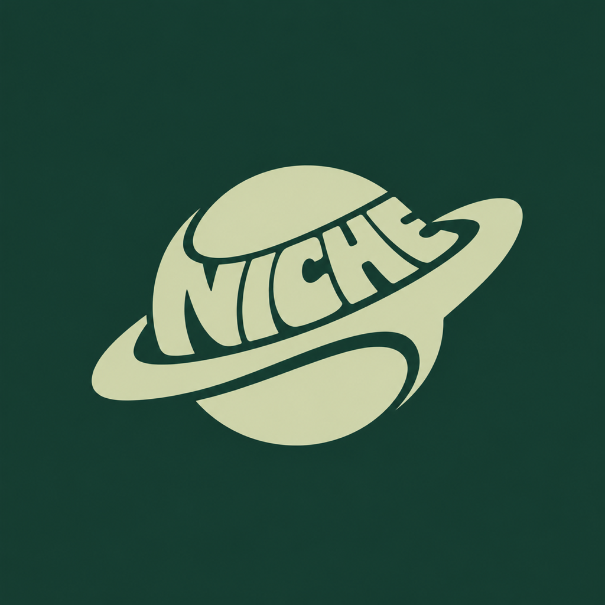
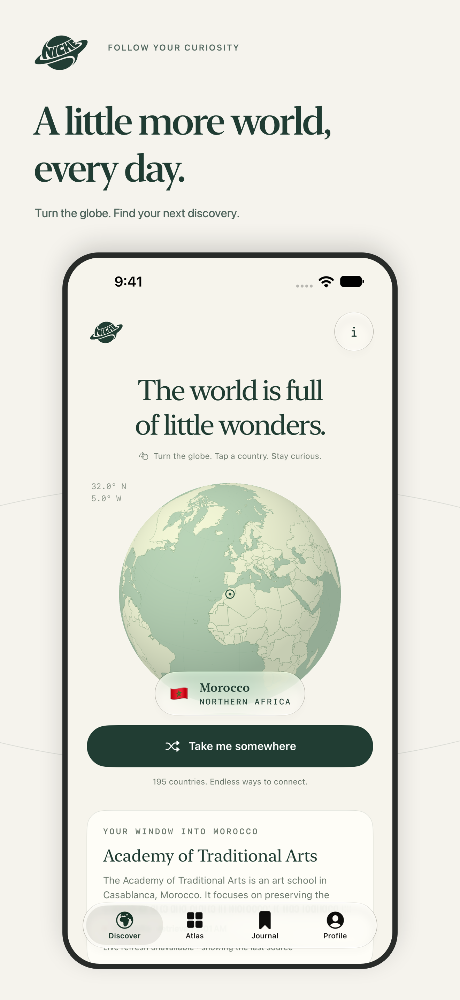
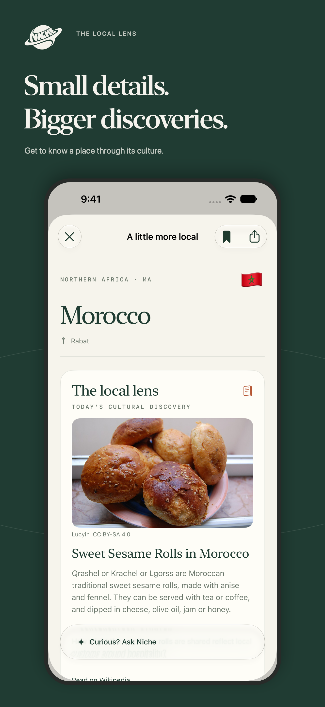
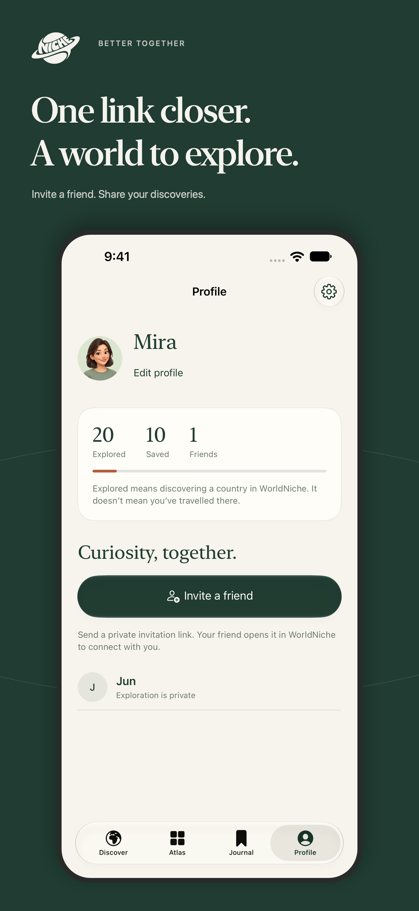

<h1 align="center"> WorldNiche</h1>

A little more world, every day.

  <a href="https://worldniche.app">Take a look</a> ·
  <a href="https://testflight.apple.com/join/kqpQhYFw">Try the beta</a> ·
  <a href="https://github.com/RedaB2/WorldNiche/releases">Releases</a>

  
  
  

### A small reason to get curious

I was on a drive with friends, talking about different countries, when one came up and I realized I knew almost nothing about its culture. So much happens there, from business to music, and I had nothing to add. I felt embarrassed. WorldNiche is my way of forcing myself to learn a little about cultures around the world, one discovery at a time.

Living in LA, it feels like everyone wants to be niche. Knowing about the world shouldn't be niche, but the little things inside each culture can be. That's where the name comes from.

### Under the globe

| Piece | What's behind it |
| --- | --- |
| iOS app | Swift 6, SwiftUI, SceneKit globe, native Sign in with Apple |
| Accounts, friends & journals | Supabase Auth, PostgreSQL with row-level security, private Storage |
| Music & culture | Apple Music charts, Global Voices news, Wikipedia and Wikimedia sources |
| AI | Apple Foundation Models on-device; OpenAI for backend profile moderation |
| Website | HTML, CSS and JavaScript, hosted on Vercel with automatic deployments from `main` |
| Checks | GitHub Actions, Swift/XCTest, Node tests and isolated PostgreSQL tests |

One repo: [`apps/ios`](apps/ios) · [`apps/web`](apps/web) · [`backend`](backend) · [`screenshots & media`](marketing/app-store)

Version **1.0 (8)** is submitted to App Review, with manual release after approval. [Submission details](docs/app-store-readiness.md).

Working on it? Start with the [single workspace](docs/local-workspace.md), [handoff](docs/handoff.md), [deployment map](docs/deployment.md) and [architecture](docs/architecture.md).
