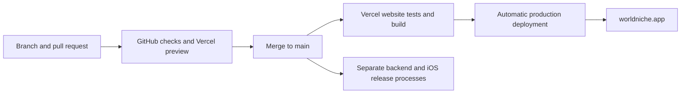

# Where WorldNiche lives

**Merge to `main` to publish the website.** Vercel runs the website checks, builds that commit and updates `worldniche.app` automatically. No chat, local Mac or deployment key in GitHub is required.

| Part | Host or account | Source |
| --- | --- | --- |
| Domain and DNS | Squarespace, `worldniche.app` | Provider settings; leave email records intact |
| Website, demos, invite pages, Apple association file | Vercel project `worldniche`, team `redab2s-projects` | `apps/web/` |
| Auth, PostgreSQL, private photos, Edge Functions | Supabase project `tgsjbjcihobumeirmzgm` | `backend/supabase/` |
| Profile moderation | OpenAI, called only by Supabase | `backend/supabase/functions/moderate-profile/` |
| Sign in with Apple and distribution | Apple team `AD6Q827Z79`, bundle `io.worldniche.app` | `apps/ios/` and App Store Connect |
| Email delivery retained from early beta | Resend SMTP, `mail.worldniche.app` | Supabase SMTP settings; current app uses Apple sign-in only |

Public identifiers are in [`ops/production.json`](../ops/production.json). They are not credentials. The Vercel project is in the owner's existing Hobby account. Squarespace still owns the domain and DNS; the apex A record points to `216.198.79.1`. The backend and iOS signing configuration are separate.

## The website pipeline



The Vercel GitHub integration watches `RedaB2/WorldNiche`, with `main` as the production branch and `apps/web` as the root directory. [`apps/web/vercel.json`](../apps/web/vercel.json) owns the build command: `npm test && npm run build:vercel`. It checks the website behavior, exact public asset bytes, routing and headers, the production Apple association file, and invitation/error responses before publishing. A failed build leaves the previous production deployment serving visitors.

GitHub's [`Checks`](../.github/workflows/ci.yml) independently runs the website/package tests, listing checksums, secret scanning, backend security/database suites and native tests. Vercel's website checks are its publication gate; unrelated iOS simulator jobs are not part of the Vercel build.

After Vercel reports success for the current `main` commit, [`Check live website`](../.github/workflows/website-live.yml) verifies the public domain and its serving commit. Preview and superseded commits are skipped. This check can also be run manually from GitHub Actions. A failed live check reports a problem; it does not automatically roll back production.

The generated `.vercel/output` uses Vercel's Build Output API. Pages, images and videos are CDN files. A small Node function handles invitations, unsupported methods and unknown URLs using the existing handler. It does not read profiles, redeem invites or need service keys. The build gets the public Apple team/bundle IDs from `ops/production.json`.

## Make a website change

1. Create a branch and edit `apps/web/landing-site`, `apps/web/invite-site` or the shared hosting code.
2. Run `bash scripts/check.sh web` and `npm --prefix apps/web run build:vercel`. Open a PR and inspect its checks and Vercel preview.
3. Merge to `main`. Vercel publishes the checked website automatically. There is no separate publish button to press.
4. Check the production deployment in [Vercel](https://vercel.com/redab2s-projects/worldniche). Its source commit should match GitHub. The public `/deployment.json` endpoint identifies the serving commit.
5. For a live verification, run:

   ```sh
   node apps/web/invite-hosting/scripts/check-live.mjs https://worldniche.app <full-commit-sha>
   ```

   This verifies all public policy pages, direct JSON AASA responses, both demo videos' byte ranges, invitation/error behavior and commit provenance. Its invitation token is synthetic and never connects accounts. Apple/iMessage testing is still needed if the association rules change.

Project settings: framework `Other`, Node `24.x`, root `apps/web`, include source outside the root directory so `ops/production.json` is available. Keep build settings in `vercel.json`; do not add production API secrets or enable analytics as part of deployment maintenance. Existing preview access controls can remain in place while the production domain stays public.

Rollback uses Vercel's previous successful production deployment. Also revert the bad commit in GitHub so the next merge preserves the correction. No DNS edits are needed for routine deployments or Vercel rollbacks.

## Previous hosting

Before October 30, 2026, the website ran on Sites project `appgprj_6ad5354a0da481919ffcd3a148d379bf`, using Cloudflare Workers. Version 16 and the `v1.0.0` release record remain historical snapshots. The `sitesProjectID` field and `scripts/prepare_site.py` remain for archival packaging; they are not the production deployment path.

The former apex A records were `162.159.143.30` and `172.66.3.26`. Do not restore them unless intentionally rolling back the hosting migration. Email and domain verification records were preserved. All source now lives in the single `/Users/rb/dev/WorldNiche` checkout.

## Native CI

The app supports iOS 26 at runtime but needs Xcode 27 to compile its availability-guarded APIs. GitHub's `xcode-27` runner covers synthetic profile and journal flows. Release testing also uses the owner's phone and unfolded Duo simulators, plus real Apple authorization when that behavior changes.

## Deploy the backend

Use the Supabase dashboard or an authenticated Supabase CLI for the project above. Verify the selected project before any write. Add a new migration for a database change; do not rewrite applied migrations. Run `bash scripts/check.sh backend` first. The test runner creates an isolated local PostgreSQL cluster and does not accept a production URL.

Link the CLI to the project, inspect remote migration history, then review `supabase db push --dry-run` before applying. Some original migrations were applied through the dashboard, so reconcile the ledger against the actual schema before the first CLI push. Never blindly replay the entire migration directory on production.

Deploy functions from `backend/` with `supabase functions deploy delete-account` or `supabase functions deploy moderate-profile`. Both have gateway JWT verification disabled in `config.toml`; their handlers verify the caller themselves. Keep that authentication intact. Local `[auth]` defaults and legacy email templates are not an authoritative snapshot of hosted Auth settings; do not push project-wide Auth configuration as part of a function deploy.

Schedules are separate operational SQL, not ordinary migrations:

| Job | Schedule (UTC) | Definition |
| --- | --- | --- |
| `worldniche-profile-checks` | Every minute | `backend/supabase/configure_profile_checks.sql` |
| `worldniche-profile-check-retention` | 03:17 daily | Same file |
| `worldniche-retention` | 03:17 daily | `backend/supabase/maintenance.sql` |

They were installed and verified before submission. Inspect jobs and recent executions before changing them; do not create duplicates. General retention preserves accounts, journals, active invitations and unresolved reports. Never run `backend/tests/bootstrap.sql` or other fixtures against the hosted database.

## Build and distribute iOS

Open `/Users/rb/dev/WorldNiche/apps/ios/WorldNiche.xcodeproj`, scheme `WorldNiche`, directly from this repo. Editing, signing and release builds use this same checkout. The public configuration intentionally supports guest use without service access.

For a configured build, put the owner's app configuration in ignored `apps/ios/WorldNiche/Resources/SocialConfiguration.local.json` and signing overrides in ignored `apps/ios/Config/Signing.local.xcconfig`. The loader prefers the local JSON. Use the Supabase **publishable/anon client key**, never a service-role key or an OpenAI key. Set the production service URL and `appleSignInEnabled: true`. Use the existing resource JSON as the field template. Keep its tracked service URL and client key blank, with Apple sign-in disabled.

Run the Swift suites and affected UI suites on phone and Duo, then live discovery, real Apple sign-in, friend access and account deletion checks when those paths change. Use a disposable account with the owner's authorization for deletion. Inspect the final bundle, privacy manifest, entitlements, source credits and release configuration with `apps/ios/Scripts/check_release_readiness.py` plus the release checklist.

Archive/export using the owner's Apple Distribution certificate and WorldNiche App Store profile. The owner's export settings are in ignored `.local/ExportOptions.local.plist`; they export a local IPA rather than uploading automatically. Put archives, IPAs and validation evidence in `outputs/`. Upload via App Store Connect only for an authorized release, wait for processing and verify the exact build's public beta group assignment. New uploads need a new build number in `apps/ios/Config/Shared.xcconfig`. Credentials and configured IPAs remain private. GitHub does not currently hold signing or App Store upload credentials, so iOS distribution is an operator-run release step.

Listing source lives in `metadata/app-info/` and `metadata/version/`. The frozen submitted listing beside the 1.0 media is a readback snapshot. Use the current App Store metadata sync tools to validate and review a future metadata diff before applying it.

Do not change the submitted build while review is pending. Check its state with:

```sh
asc submit status --id 2128740a-4e7d-4e44-b4d9-7037e89013e7
asc versions view --version-id 41861671-736b-4776-be96-f52aabd20343 --include-build
```

The local `asc` keychain profile is named `Tech Bros Budget`; the verified app/team IDs above determine the target. On another Mac, authenticate with owner-authorized App Store Connect access. Never export a signing private key into Git.

## Credential locations

| Credential | Where it belongs |
| --- | --- |
| `OPENAI_API_KEY` | Supabase Edge secrets; moderation-only permissions |
| `WORLDNICHE_MODERATION_WORKER_SECRET` | Supabase Edge secrets and Vault entry `worldniche_moderation_worker_secret` |
| Worker URL | Vault entry `worldniche_moderation_url` |
| `APPLE_CLIENT_ID`, `APPLE_TEAM_ID`, `APPLE_KEY_ID`, `APPLE_PRIVATE_KEY` | Supabase Edge secrets for Apple revocation |
| Supabase service-role credentials | Backend secret store only; platform supplies Edge runtime values |
| Resend restricted SMTP key | Supabase Auth SMTP password |
| Apple distribution certificate/private key and ASC API key | Owner's Keychain/private credential storage |
| App client config | Ignored `SocialConfiguration.local.json`; only public client access |

On the existing Mac, an operator-only OpenAI copy is in `/Users/rb/dev/WorldNiche/backend/.env.local`. Do not source or print it just to inspect the project. Cloud moderation does not depend on this Mac staying on. New agents can work on code and CI without these secrets; production operations require authenticated service access. Private files, local archives and generated build products are ignored and checked by the [repository safeguards](local-workspace.md).

## Release tags

`v1.0.0` identifies the first submitted app, **1.0 (8)**, plus its website/backend source, media and handoff docs. It is not an App Store approval announcement. Release notes must retain that distinction. Future tags are immutable; use a new version for a new release. Keep public release artifacts limited to source and public marketing media, never signed configured binaries or private review evidence.
