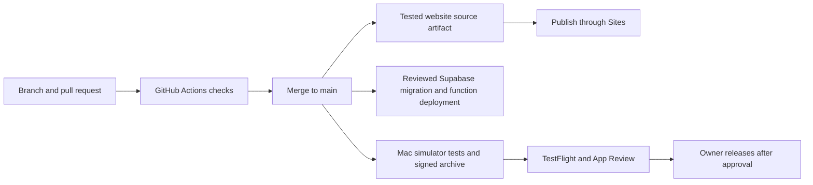

# Where WorldNiche lives

GitHub stores the code. Each running part has its own host. **A push does not automatically change production.**

| Part | Host or account | Source |
| --- | --- | --- |
| Domain and DNS | Squarespace, `worldniche.app` | Provider settings; leave email and verification records intact |
| Website, demos, invite pages, Apple association file | Sites, running on Cloudflare Workers | `apps/web/` |
| Auth, PostgreSQL, private photos, Edge Functions | Supabase project `tgsjbjcihobumeirmzgm` | `backend/supabase/` |
| Profile moderation | OpenAI, called only by Supabase | `backend/supabase/functions/moderate-profile/` |
| Sign in with Apple and distribution | Apple team `AD6Q827Z79`, bundle `io.worldniche.app` | `apps/ios/` and App Store Connect |
| Email delivery retained from early beta | Resend SMTP, `mail.worldniche.app` | Supabase SMTP settings; current app uses Apple sign-in only |

Public identifiers are in [`ops/production.json`](../ops/production.json). They are not credentials. Sites currently serves version 16 with active HTTPS on the custom domain. Squarespace DNS points the apex to `162.159.143.30` and `172.66.3.26`. Do not move the domain or recreate the Site to deploy an edit.

## The pipeline



[`Checks`](../.github/workflows/ci.yml) runs on PRs, pushes to `main`, or manual dispatch. It checks secrets, website behavior and packaging, listing hashes, deletion/moderation handlers, database permissions/races/retention, six Swift suites, and profile/journal simulator flows. It uses synthetic data, no production credentials and no paid AI calls.

After all checks pass on `main`, CI builds a website delivery artifact tied to that exact commit. Download `website-delivery-<commit>` from the successful run. It contains source, public routing configuration, `provenance.json` and the validated Worker output. This is **continuous integration and delivery with an explicit production publish step**, not unattended deployment.

GitHub's [runner inventory](https://github.com/actions/runner-images/blob/main/images/macos/macos-26-Readme.md) lists Xcode 26.6 on `macos-26`, used for the iOS 26 baseline in CI. Release testing also uses the owner's Xcode 27 phone/Duo simulators. Hosted CI does not replace those checks or a real Apple authorization test.

## Publish the website

1. Start from a passing, pushed commit. To reproduce the CI artifact locally:

   ```sh
   python3 scripts/prepare_site.py --ref HEAD --output outputs/site
   ```

   The output directory must not exist. This exports committed files only, includes no ignored local files and runs the website tests/build/validation. Uncommitted edits are intentionally excluded.

2. Connect the owner's **Sites** account. Read the current Site using project ID `appgprj_6ad5354a0da481919ffcd3a148d379bf`; preserve its public audience and custom domain. Use the installed Sites skill's current source workflow. Obtain a short-lived source write credential and open the existing Site repository in a fresh temporary checkout. Keep credentials in memory/stdin only.
3. Copy the prepared snapshot into that checkout, preserving its `.git`. Remove obsolete source files from the prior layout after reviewing the diff. The new snapshot is self-contained; the root `npm test`, `npm run build` and `npm run validate` work without the old local folder layout. Preserve `.openai/hosting.json` with this exact Site ID.
4. The Sites source helper commits/pushes that snapshot to the **Sites source repository**, then packages its `dist/`. Use the helper's returned commit and archive with `save_site_version`, then `deploy_site_version`. A GitHub SHA and a Sites source SHA are different: `provenance.json` connects them. Do not pass a GitHub SHA as an unpushed Sites commit.
5. Verify successful deployment, then check `/`, `/privacy`, `/support`, an invitation fallback, both demo videos and `/.well-known/apple-app-site-association`. The AASA must be direct JSON and identify `AD6Q827Z79.io.worldniche.app` for `/invite/*`. Test an actual Messages link after association changes.
6. Record the GitHub commit, Sites version/source commit/deployment ID in `ops/releases/` and the relevant release notes. Rollback uses a previously saved Sites version; it does not reset Git history.

The website currently uses no runtime API secrets. Sites controls its Cloudflare deployment; this is not a Cloudflare project in the owner's separate account. There is no configured GitHub-to-Sites auto-publish hook. The native Sites connector and source credential workflow are the supported publishing route. Do not store a short-lived Sites token as a permanent GitHub secret.

## Deploy the backend

Use the Supabase dashboard or an authenticated Supabase CLI for the project above. Verify the selected project before any write. Add a new migration for a database change; do not rewrite applied migrations. Run `bash scripts/check.sh backend` first. The test runner creates an isolated local PostgreSQL cluster and does not accept a production URL.

Link the CLI to the project, inspect remote migration history, then review `supabase db push --dry-run` before applying. Some original migrations were applied through the dashboard, so reconcile the ledger against the actual schema before the first CLI push. Never blindly replay the entire migration directory on production.

Deploy functions from `backend/` with `supabase functions deploy delete-account` or `supabase functions deploy moderate-profile`. Both have gateway JWT verification disabled in `config.toml`; their handlers verify the caller themselves. Keep that authentication intact. Local `[auth]` defaults and legacy email templates are not an authoritative snapshot of hosted Auth settings; do not push project-wide Auth configuration as part of a function deploy.

Schedules are separate operational SQL, not ordinary migrations:

| Job | Schedule (UTC) | Definition |
| --- | --- | --- |
| `worldniche-profile-checks` | Every minute | `backend/supabase/configure_profile_checks.sql` |
| `worldniche-profile-check-retention` | 03:17 daily | Same file |
| `worldniche-retention` | 03:17 daily | `backend/supabase/maintenance.sql` |

They were installed and verified before submission. Inspect jobs and recent executions before changing them; do not create duplicates. General retention preserves accounts, journals, active invitations and unresolved reports. Never run `backend/tests/bootstrap.sql` or other fixtures against the hosted database.

## Build and distribute iOS

Open `apps/ios/WorldNiche.xcodeproj`, scheme `WorldNiche`, directly from this repo. The public configuration intentionally supports guest use without service access.

For a configured build, put the owner's app configuration in ignored `apps/ios/WorldNiche/Resources/SocialConfiguration.local.json` and signing overrides in ignored `apps/ios/Config/Signing.local.xcconfig`. The loader prefers the local JSON. Use the Supabase **publishable/anon client key**, never a service-role key or an OpenAI key. Set the production service URL and `appleSignInEnabled: true`. Use the existing resource JSON as the field template. Do not overwrite the tracked blank template.

Run the Swift suites and affected UI suites on phone and Duo, then live discovery, real Apple sign-in, friend access and account deletion checks when those paths change. Use a disposable account with the owner's authorization for deletion. Inspect the final bundle, privacy manifest, entitlements, source credits and release configuration with `apps/ios/Scripts/check_release_readiness.py` plus the release checklist.

Archive/export using the owner's Apple Distribution certificate and WorldNiche App Store profile, upload via App Store Connect, wait for processing and verify the exact build's public beta group assignment. New uploads need a new build number in `Config/Shared.xcconfig`. Credentials and configured IPAs remain private. GitHub does not currently hold signing or App Store upload credentials, so iOS distribution is an operator-run release step.

Do not change the submitted build while review is pending. Check its state with:

Listing source lives in `metadata/app-info/` and `metadata/version/`. The frozen submitted listing beside the 1.0 media is a readback snapshot. Use the current App Store metadata sync tools to validate and review a future metadata diff before applying it.

```sh
asc submit status --id 2128740a-4e7d-4e44-b4d9-7037e89013e7
asc versions view --version-id 41861671-736b-4776-be96-f52aabd20343 --include-build
```

The local `asc` keychain profile is named `Tech Bros Budget`; the verified app/team IDs above determine the target. On another Mac, authenticate with owner-authorized App Store Connect access. Never export a signing private key into Git.

## Credential locations

| Credential | Where it belongs |
| --- | --- |
| `OPENAI_API_KEY` | Supabase Edge secrets; moderation-only permissions |
| `WORLDNICHE_MODERATION_WORKER_SECRET` | Supabase Edge secrets and Vault entry `worldniche_moderation_worker_secret` |
| Worker URL | Vault entry `worldniche_moderation_url` |
| `APPLE_CLIENT_ID`, `APPLE_TEAM_ID`, `APPLE_KEY_ID`, `APPLE_PRIVATE_KEY` | Supabase Edge secrets for Apple revocation |
| Supabase service-role credentials | Backend secret store only; platform supplies Edge runtime values |
| Resend restricted SMTP key | Supabase Auth SMTP password |
| Apple distribution certificate/private key and ASC API key | Owner's Keychain/private credential storage |
| App client config | Ignored `SocialConfiguration.local.json`; only public client access |

On the existing Mac, an operator-only OpenAI copy is in `/Users/rb/dev/WorldNiche/Backend/.env.local`. Do not source or print it just to inspect the project. Cloud moderation does not depend on this Mac staying on. New agents can work on code and CI without these secrets; production operations require authenticated service access.

## Release tags

`v1.0.0` identifies the first submitted app, **1.0 (8)**, plus its website/backend source, media and handoff docs. It is not an App Store approval announcement. Release notes must retain that distinction. Future tags are immutable; use a new version for a new release. Keep public release artifacts limited to source and public marketing media, never signed configured binaries or private review evidence.
